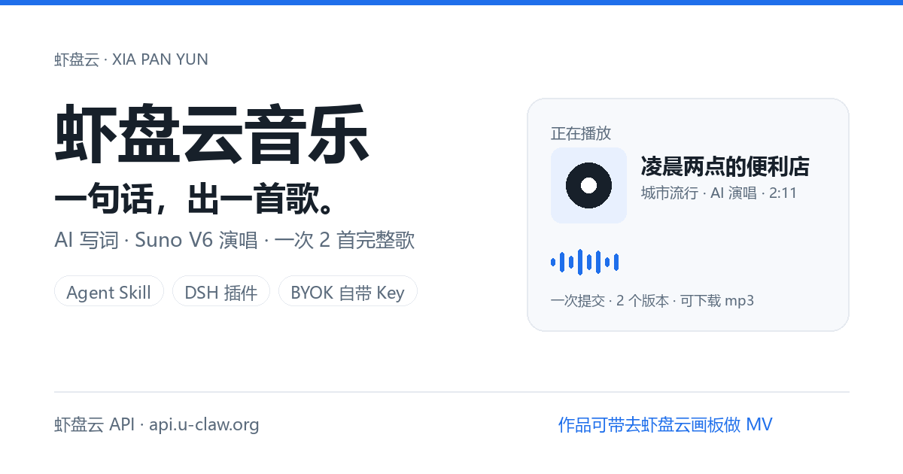
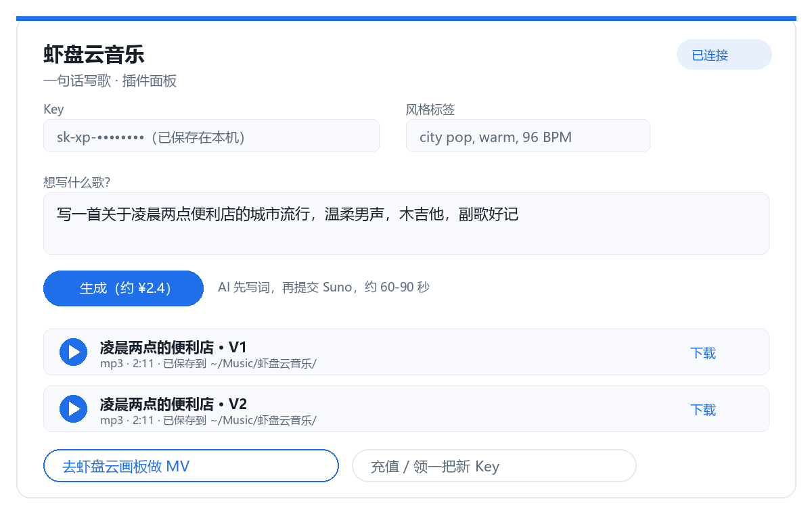

# 虾盘云音乐 · Xiapan Music



> **一句话出歌：你说想听什么，AI 写词 + Suno V6 编曲演唱，一次出 2 首完整歌（每首约 2 分钟），下载就能听。**
> 一个仓，两个入口：**Agent Skill**（Claude Code / OpenClaw / DSH / Codex 都能装）+ **DeepSeek Harness 插件**（`dsh plugin add dsh-xiapan-music`）。
> 底层走[虾盘云](https://api.u-claw.org.cn) API，一把 `sk-...` Key 全通；做出来的歌可以带去[虾盘云画板](https://tu.u-claw.org.cn/?utm_source=github&utm_medium=readme&utm_campaign=xiapan-music)配画面、做 MV。

[](LICENSE)
[](package.json)
[](https://github.com/dongsheng123132/xiapan-music/releases/latest)
[](https://github.com/dongsheng123132/xiapan-music/actions/workflows/ci.yml)



**上架入口**：[GitHub](https://github.com/dongsheng123132/xiapan-music) · [SkillHub 技能](https://skillhub.cn/skills/user_abeb50e0/xiapan-music) · ClawHub（`clawhub install xiapan-music`，审核通过后可见） · npm（`dsh-xiapan-music`，发布中） · [Release v0.1.0](https://github.com/dongsheng123132/xiapan-music/releases/tag/v0.1.0)

---

## 30 秒上手

1. 拿一把虾盘云 Key：注册 [api.u-claw.org.cn](https://api.u-claw.org.cn)（令牌管理 → 创建）→ 充值 [api.u-claw.org.cn/recharge](https://api.u-claw.org.cn/recharge)（¥10 起）。**装了虾盘 U 盘 / U-King 的电脑不用配，自动用设备 Key。**
2. 装 Skill 或插件（下面任选）。
3. 对 AI 说一句：**「写一首关于凌晨两点便利店的温柔 city pop」** → 它写词、出歌、给你 mp3。

> 费用：Suno 出歌约 **¥2.4 / 一次（一次出 2 首完整歌）**；纯音乐 BGM 约 ¥1/首；写词用文本模型，成本忽略不计。**以虾盘云实际扣费为准。**

## 安装

### 方式 A：Agent Skill（任何支持 SKILL.md 的 Agent）

```bash
npx skills add dongsheng123132/xiapan-music --skill xiapan-music -g -y
```

ClawHub / SkillHub 上架后也可直接搜「虾盘云音乐」安装。手动方式：把 `skills/xiapan-music/` 整个目录拷进目标 Agent 的 skills 目录（如 `~/.claude/skills/`、`~/.openclaw/skills/`、`~/.dsh/skills/`）。

### 方式 B：DeepSeek Harness 插件

```bash
dsh plugin --profile web add dsh-xiapan-music
# 发布前尝鲜：dsh plugin --profile web add github:dongsheng123132/xiapan-music
```

装完重启 DSH，插件会自动注册「音乐」技能与 `xiapan_music` 工具。Key 放法（任选）：
- 已装虾盘 U 盘 / U-King：**零配置**，脚本自动读 `~/.uking/device.json`；
- 或在 `~/.dsh/.credentials.yaml` 的 refs 里加 `XIAPAN_API_KEY: sk-...`；
- 或环境变量 `export XIAPAN_API_KEY=sk-...`。

## 能做什么

- **一句话出歌**（有人声、完整编曲）：中文/英文都行，自动写词 + 出 2 个版本；
- **已有歌词谱曲**：把你的词直接唱出来，默认一字不改；
- **纯音乐 / BGM**：视频配乐、口播背景、播客片头；
- **查余额**：这把 Key 还能写多少歌；
- 出歌后给下一步 CTA：去**虾盘云画板**贴画面、排歌词、做 MV。

## 仓库结构（一仓双入口）

```
├── index.mjs / cordis.patch.yml / package.json   # DSH 插件入口（npm 包 dsh-xiapan-music）
├── skills/xiapan-music/                          # Agent Skill 入口（自包含）
├── src/core/xiapan-music.mjs                     # 零依赖核心客户端（插件与 Skill 共用）
├── scripts/                                      # 同步/校验脚本
├── assets/                                       # 上架首图/示意图
└── docs/                                         # 计划、API 契约、市场调研、发布 runbook
```

## 开发

```bash
node scripts/sync-core.mjs --check     # 核心与技能里的副本是否一致（sha256）
node scripts/test-core.mjs             # Core 单元测试（假 fetch，零扣费）
node --test                            # 插件/工具测试
dsh plugin --profile <test> add .      # 隔离 profile 里本地加载插件
```

## 相关

- [虾盘云](https://api.u-claw.org.cn) · [充值](https://api.u-claw.org.cn/recharge) · [虾盘云画板](https://tu.u-claw.org.cn/?utm_source=github&utm_medium=readme&utm_campaign=xiapan-music) · [U-King 装机管家](https://www.u-king.org/)
- 同类开源：[U-King AIGC 技能](https://github.com/dongsheng123132/uking-aigc)（作图/视频）

## License

MIT © 火火的（深圳）科技有限公司 / dongsheng123132
